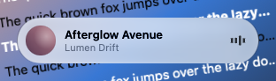
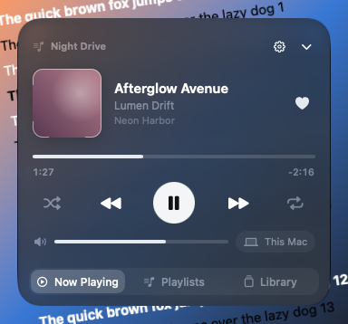
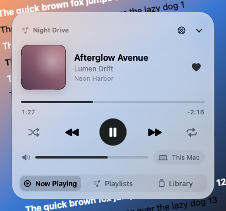
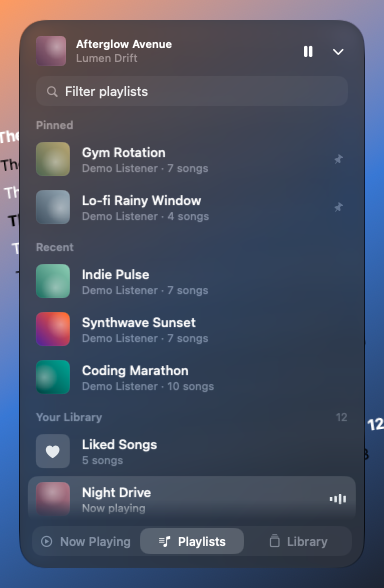
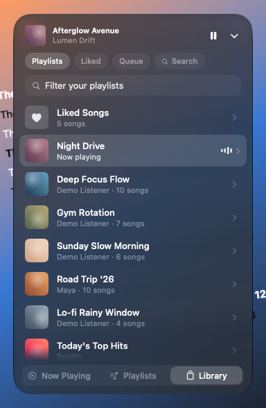
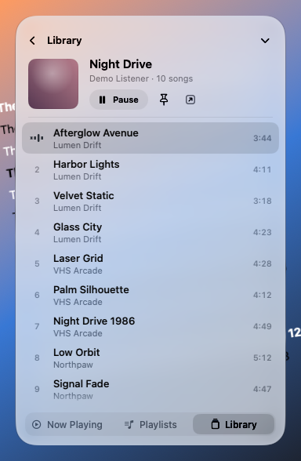

# Orbit

Orbit is a small floating controller for Spotify on macOS 26 and later. A translucent pill sits above your windows and expands into a player, a quick playlist picker and a compact library, so you can change what is playing without bringing Spotify's window forward. The Spotify desktop app still plays the audio; Orbit only controls it.

## Screenshots

These were captured from Orbit's demo mode, which uses made-up playlists and artwork. The colored background is drawn by a debug option to stand in for a desktop behind the glass.

<p>
  
  
</p>

<p>
  
  
</p>

<p>
  
  
  
</p>

## Features

- **Pill.** Shows artwork, the track title and artist, and a playing indicator. Hovering reveals previous, play/pause and next buttons (play/pause and next only on the compact size). Click to expand, drag to move. Two sizes.
- **Player.** Artwork, title, artist and album; seek bar; shuffle, previous, play/pause, next and repeat (off, all, one); volume; save to or remove from Liked Songs; a device list for Spotify Connect; the name of the playlist that is playing, which opens the playlist picker. A gear opens Settings.
- **Playlist picker.** Pinned playlists first, then up to eight playlists you recently started from Orbit, then your whole library with Liked Songs on top. Type to filter; Return plays the selected or top match. Orbit shows the switch as pending until it sees Spotify playing the playlist, and shows an error with a retry when it does not.
- **Mini library.** Playlists, Liked Songs, the queue, and search for songs, albums and playlists. Open a playlist to see its tracks, where Spotify allows it, and to play, pin or open it in Spotify. Right-click a song to play it, add it to the queue or open it in Spotify; right-click a playlist to play it, pin or unpin it, move a pin up or down, remove it from recents or open it in Spotify.
- **Positioning.** Snapping to screen edges, optional docking at the top center, a remembered position per display, and recovery when a display is disconnected or the saved position is offscreen.
- **Behavior.** Keep above other windows, hide while another app is full screen, hide when Spotify quits, collapse after choosing music, launch at login, and a preferred Spotify Connect device.
- **Synchronization.** Settings > Spotify sets how often Orbit checks Spotify's servers for playback on your other devices: Automatically, Less often, or Only while Orbit is open. Refresh Now reloads your library from Spotify at once. See [How often Orbit talks to Spotify](docs/SPOTIFY_SETUP.md#how-often-orbit-talks-to-spotify).
- **Appearance.** System, light or dark; Clear, Balanced or Tinted glass; a background opacity slider; five accent colors plus a custom one; a Reduce animation switch. The glass presets use macOS's two native Liquid Glass variants, plus a backing layer and tint that Orbit draws itself. Orbit cannot change how strongly the native glass blurs.
- **Menu bar item.** Now playing, play/pause, next, previous, open the player, playlists, search, show or hide the pill, reset its position, About Orbit (which lists the third-party software Orbit includes and its license), Settings and Quit.
- **Global shortcuts.** Open or close Orbit, search, play or pause, next, previous, open the playlist picker. All are off until you record a key combination in Settings > Shortcuts.

Playback controls work without signing in, through macOS Automation, as long as the Spotify app is running on the same Mac. Playlists, Liked Songs, search, the queue, saving songs and switching devices need a Spotify sign-in.

### Keyboard

These keys work while the expanded panel is open and active, which it is after you click the pill or open it from the menu bar or a shortcut. They follow Spotify's own desktop shortcuts where there is one.

| Key | What it does |
|---|---|
| Space | Play or pause |
| Left / Right arrow | Seek back or forward 10 seconds (player only) |
| Command-Left / Command-Right | Previous or next track |
| Command-Up / Command-Down | Volume up or down by 10 |
| Up / Down arrow | Move the selection in a list (the picker, library playlists, Liked Songs, search results, a playlist's tracks) |
| Return | Play the selected item, or the top match while filtering |
| Typing | Goes into the filter or search field, when the screen has one |
| Escape | Clears the field if it has text; otherwise goes back one step (from a playlist or the device list to the screen it came from, from the picker or library to the player) and, from the player, collapses Orbit |
| Command-comma | Open Settings |

In a list, the arrow keys and Return act on the list even while its filter field has focus; other keys type into the field, so Space is not play/pause there. Holding an arrow repeats seeking, skipping and volume changes but never play/pause or Escape.

### Accessibility

- **VoiceOver.** Controls have labels. The pill reads as a single button that describes what is playing and offers Play or Pause, Next Track and Previous Track as actions. Playlist and song rows read as one item each and offer their right-click commands (pin, add to queue, open in Spotify and so on) as actions.
- **Reduce Motion.** Orbit shortens its animations and replaces slides with fades. Settings > Appearance > Reduce animation does the same for Orbit alone.
- **Reduce Transparency.** Orbit draws an almost opaque backing under the glass, whatever the opacity slider says.
- **Increase Contrast.** Orbit raises the minimum backing opacity, draws a border around the pill and panel, and strengthens fills and selection colors.

### Performance

Measured on one Mac, with a Release build in demo mode: a collapsed pill playing music used about 0.1% CPU and about 27 MB of memory. These are measurements of that setup, not guarantees; a real Spotify account adds network requests, and your numbers will differ.

## Requirements

- macOS 26 or later.
- The Spotify desktop app.
- A Spotify Client ID from a Spotify Developer app. Spotify runs such apps in Development Mode, which requires the account that owns the developer app to have Spotify Premium and allows up to five users per app. See [docs/SPOTIFY_SETUP.md](docs/SPOTIFY_SETUP.md).

## Install from a release

1. Download `Orbit-<version>.zip` from the repository's Releases page.
2. If the release lists a SHA-256 checksum, compare it:

   ```
   shasum -a 256 ~/Downloads/Orbit-<version>.zip
   ```

3. Double-click the zip to extract it in Finder. It contains a folder with `Orbit.app`, Orbit's license and the third-party notices. Move `Orbit.app` to `/Applications`.
4. Open Orbit. The first launch is blocked by Gatekeeper; see below.
5. Orbit has no Dock icon. Look for the pill on screen and the Orbit item in the menu bar.

### Gatekeeper

Release builds are signed ad hoc and are not notarized, because notarization requires a paid Apple Developer Program membership. Your browser marks the downloaded zip as quarantined and Finder passes the mark on to the extracted app, so Gatekeeper checks Orbit the first time you open it. Gatekeeper accepts only apps from the App Store or notarized apps signed with a Developer ID, so it refuses Orbit: macOS says Orbit was not opened because Apple could not verify it is free of malware, and offers Done and Move to Trash. If you trust where you got it:

1. Click Done. Do not choose Move to Trash.
2. Open System Settings > Privacy & Security and scroll to the Security section. It says Orbit was blocked.
3. Click Open Anyway and confirm with your password or Touch ID. Orbit opens.

You only need to do this once per downloaded copy. Right-clicking the app and choosing Open no longer gets past the warning on current macOS, so use Open Anyway. If macOS instead says Orbit is damaged, the copy is broken; see [docs/TROUBLESHOOTING.md](docs/TROUBLESHOOTING.md).

Do not turn off Gatekeeper to run Orbit, and do not run commands that disable it system-wide or strip the quarantine mark. If you would rather not trust a downloaded binary, build Orbit from source.

Because each ad-hoc signed build has a different signature, macOS asks again for Keychain and Automation access after you install an update. See [docs/TROUBLESHOOTING.md](docs/TROUBLESHOOTING.md).

## Set up Spotify

Orbit talks to Spotify's Web API with a Client ID from a Spotify Developer app. A release may have the author's Client ID built in; in that case the author has to add your Spotify account to the app's user list before you can sign in. Otherwise create your own app and paste its Client ID into Settings > Spotify.

[docs/SPOTIFY_SETUP.md](docs/SPOTIFY_SETUP.md) walks through creating the app, adding users, where the Client ID goes, the first sign-in, and what Development Mode limits mean.

## Permissions

Orbit asks for:

- **Automation for Spotify.** Lets Orbit send play, pause, skip, seek, volume, shuffle and repeat commands to the Spotify app on this Mac, and read what it is playing. macOS asks the first time you use a playback control while Spotify is running, or when you click Allow in Orbit. If you deny it, Orbit sends commands through the Web API instead when you are signed in.
- **Keychain access.** Orbit stores your Spotify tokens in your login keychain. macOS may ask you to allow access after Orbit is updated or rebuilt.
- **Login Items**, only if you turn on Launch at login. macOS may ask you to approve it in System Settings > General > Login Items.

Orbit does not need Accessibility, Input Monitoring, Screen Recording, Full Disk Access, location, contacts or the microphone. Global shortcuts are registered as system hot keys, which need no permission. Full-screen detection reads window positions only, which needs no Screen Recording permission. Orbit is not sandboxed.

## Privacy

Orbit has no server, no account system, no analytics, no crash reporting and no update checks.

What leaves your Mac, and to whom:

- **To Spotify's accounts service (`accounts.spotify.com`):** the sign-in page opens in your browser, and Orbit exchanges the authorization code and later refreshes your tokens there. Sign-in uses Authorization Code with PKCE and no client secret.
- **To Spotify's Web API (`api.spotify.com`):** requests for your profile, playlists, playlist tracks, Liked Songs, search terms you type, playback state, devices and the queue, plus the playback, queue and library commands you issue.
- **To Spotify's image servers:** requests for the artwork URLs that Spotify supplies.

Nothing is sent anywhere else. Commands to the Spotify app on your Mac go over local Apple events.

What stays on your Mac:

- Spotify tokens, in your login keychain as an item labeled "Orbit Spotify session". Signing out deletes it. Tokens are never written to logs.
- Settings, including any Client ID you enter, in Orbit's preferences (`io.github.ntony46.orbit`).
- Pinned and recent playlists, in `~/Library/Application Support/Orbit/Library.json`.
- An artwork cache of up to 64 MB in Orbit's Caches folder.

The sign-in callback listener accepts connections only on `127.0.0.1` port 8888, only while a sign-in is in progress, and shuts down after the callback for that sign-in arrives or after five minutes.

To remove Orbit's access from the Spotify side as well, remove it at [spotify.com/account/apps](https://www.spotify.com/account/apps/).

## Security notes

Orbit signs in with Authorization Code with PKCE, the OAuth flow for apps that cannot keep a client secret. What it does:

- Uses PKCE with the S256 method and a fresh random verifier for each sign-in. The verifier is kept only in memory.
- Sends a random `state` value with each sign-in and accepts only a callback that returns it.
- Receives the callback on a listener bound to `127.0.0.1` only, not to other network interfaces. Requests with a missing or wrong `state` get an error page and are otherwise ignored; the listener keeps waiting for the real callback.
- Has no client secret, so there is none to leak.
- Keeps tokens only in the login keychain and in memory.
- Refuses HTTP redirects on token and Web API requests, so a token is never re-sent to another address.

Some risks come with any app that signs in through a browser and a local listener, and Orbit cannot remove them:

- A Client ID is public. Any program running as you can start its own sign-in with Orbit's Client ID and its own listener on port 8888. If you approved Orbit before, Spotify may skip the consent screen and send that program a code without asking you again.
- The authorization code ends up in your browser history as part of the callback address. On its own it is useless: exchanging it for tokens needs the PKCE verifier that only the Orbit that started the sign-in holds, in memory.
- Signing out deletes the tokens on your Mac but cannot revoke them at Spotify. To cut off access completely, remove Orbit at [spotify.com/account/apps](https://www.spotify.com/account/apps/).
- Malware already running as your user can read Orbit's keychain item if you approve its access request, and can take port 8888 before Orbit does. In the second case Orbit reports that the port is in use and does not open the browser, so its own sign-in never sends a code to that program.

## Known limitations

- Spotify Development Mode allows at most five users per Client ID, requires the app owner to have Premium, and shares one request quota across the owner's Development Mode apps and everyone using them.
- Spotify returns the tracks of a playlist only if you own it or collaborate on it. Other playlists still play, but Orbit cannot list their tracks.
- Search returns at most 10 songs, 10 albums and 10 playlists per query. Artists, podcasts and audiobooks are not searched.
- AppleScript only knows repeat on or off, so Repeat One needs the Web API and therefore a sign-in.
- Switching devices and controlling Spotify on other devices go through the Web API, which Spotify restricts to Premium accounts.
- The sign-in callback uses port 8888, which cannot be changed. Sign-in fails while another program uses that port.
- Releases are not notarized and have no automatic updates.
- Orbit does not play audio itself. Without a sign-in it can only control the Spotify desktop app on the same Mac.

## Build from source

You need macOS 26 or later and a recent Xcode with the macOS 26 SDK (the project is developed with Xcode 27.2; the Swift package requires Swift tools 6.2). No paid Apple Developer account is needed: the project signs ad hoc by default.

1. Clone the repository.

2. Optionally create a local configuration with your Client ID:

   ```
   cp Config/Local.example.xcconfig Config/Local.xcconfig
   ```

   then set `SPOTIFY_CLIENT_ID = your_client_id_here` in it. `Config/Local.xcconfig` is gitignored. Without it Orbit builds signed ad hoc with no Client ID, and you enter the Client ID in Orbit's Settings instead.

3. Build and run, either in Xcode:

   ```
   open Orbit.xcodeproj
   ```

   then choose the Orbit scheme and Product > Run; or from the command line:

   ```
   xcodebuild -project Orbit.xcodeproj -scheme Orbit -configuration Debug -derivedDataPath build build
   open build/Build/Products/Debug/Orbit.app
   ```

   The first build downloads the one Swift package dependency. XcodeGen is not needed; see below.

### Stable signing for your own Mac

macOS records the Automation grant and the keychain item's access list against the app's designated requirement, the rule that says which code counts as "this app". For an ad-hoc build that rule is the hash of that exact build, so every rebuild is a new app to macOS and it asks for Keychain and Automation access again. For an app signed with a certificate, the rule names the bundle identifier and the certificate instead, and both stay the same from one build to the next, so the grants carry over.

To get that, sign with a certificate: uncomment the three signing lines in `Config/Local.xcconfig` and set `DEVELOPMENT_TEAM` to your certificate's team ID (the example file shows how to read it). Any Apple Development certificate works, including the free one Xcode creates when you add an Apple ID under Xcode > Settings > Accounts. Grants given to an ad-hoc build do not carry over, so macOS asks once more the first time you run the signed copy.

```
Scripts/install-local.sh [--destination folder] [--quit-running] [alias-folder]
```

This makes a clean Release build with that identity, refuses an ad-hoc result, installs it as `Orbit.app` in `/Applications` (or `--destination`) and keeps a copy in `dist/Orbit.app`. It will not replace a running copy unless you pass `--quit-running`, which quits that copy first. Given an alias folder, it also writes a Finder alias named Orbit there rather than a second copy. Keep a single installed copy, so launch at login and the permission grants refer to one app.

### Release archive

```
Scripts/archive.sh
```

This makes a clean Release build, signs it ad hoc whatever `Local.xcconfig` says, verifies the signature, checks that the third-party notices match the bundled packages' licenses, and writes `dist/Orbit-<version>.zip` containing `Orbit.app`, `LICENSE.txt` and `Acknowledgements.txt`. It prints the architectures, whether a Client ID is built in, and the archive's SHA-256 checksum. A `SPOTIFY_CLIENT_ID` in `Config/Local.xcconfig` is built into the archive, so everyone who uses that copy signs in through your Spotify app, needs to be on its user list and shares its quota.

### When to run XcodeGen

`Orbit.xcodeproj` is generated from `project.yml` by [XcodeGen](https://github.com/yonaskolb/XcodeGen) and committed, so you do not need XcodeGen to build. Regenerate the project after you edit `project.yml` (including the Info.plist and entitlement properties it defines, which overwrite `App/Info.plist` and `App/Orbit.entitlements`) or add, remove or rename files under `App/`:

```
brew install xcodegen
xcodegen generate
```

Changes inside `OrbitKit/` or to the `.xcconfig` files do not need it.

## Development

The app target in `App/` is a thin entry point. All the code lives in the local Swift package `OrbitKit`:

| Module | Contents |
|---|---|
| `OrbitCore` | Domain models, service protocols, errors, preferences, the panel contract |
| `SpotifyKit` | OAuth with PKCE, the loopback callback listener, Keychain storage, the Web API client |
| `OrbitEngine` | Spotify automation through Apple events, the playback coordinator, library and account stores, persistence |
| `OrbitUI` | The design system and every SwiftUI view |
| `OrbitShell` | The floating panel, positioning, menu bar item, Settings window, shortcuts, app lifecycle, and the one place concrete services are built |
| `OrbitMocks` | Mock services and fixtures for tests, previews and demo mode |

Dependencies point one way: `OrbitCore` <- `SpotifyKit`, `OrbitEngine` <- `OrbitUI` <- `OrbitShell`.

Run the unit tests:

```
cd OrbitKit
swift test
```

Run with mock services, which needs no Spotify account, does not talk to the Spotify app and uses a throwaway settings store:

```
open build/Build/Products/Debug/Orbit.app --args --demo
```

Other launch arguments, mainly for screenshots and tests, are documented in `OrbitKit/Sources/OrbitShell/LaunchOptions.swift` and, for Debug builds, `OrbitKit/Sources/OrbitUI/Support/UIDebugOptions.swift`. `Scripts/screenshot.sh` launches the Debug build in the background, captures one of its windows by window ID and quits it, without moving the pointer or changing focus; the screenshots above were made with it, for example:

```
Scripts/screenshot.sh docs/images/player-dark.png --demo --expanded --appearance dark --ui-backdrop gradient
```

It needs Screen Recording permission for the terminal app. Project conventions are in `CLAUDE.md`.

## Acknowledgements

- [KeyboardShortcuts](https://github.com/sindresorhus/KeyboardShortcuts) by Sindre Sorhus, MIT License. Used for user-assigned global shortcuts. Its license is reproduced in `App/Acknowledgements.txt`, which Orbit shows under About Orbit in the menu bar item.

## License

Orbit is released under the MIT License. See [LICENSE](LICENSE).

Orbit is an independent project. It is not affiliated with, endorsed by or sponsored by Spotify. Spotify is a trademark of Spotify AB.
