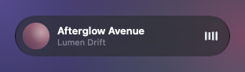

<p align="center">
  
</p>

# Orbit

A small floating Spotify controller for macOS. A translucent pill sits above your windows and expands into a player and your library, so you can change what's playing without switching to Spotify. The Spotify app still plays the audio; Orbit controls it.

<p>
  
</p>

<p>
  
  
</p>

## Features

- **Floating pill** with artwork, track info and hover controls. Drag it anywhere; it snaps to screen edges and remembers its spot on each display.
- **Full player** with seek, shuffle, repeat, volume, Liked Songs, the queue and Spotify Connect devices.
- **Library and search** in one list: pinned and recent playlists, your library, and Spotify search.
- **Liquid Glass look** with light and dark modes, glass presets and accent colors.
- **Menu bar item, global shortcuts and keyboard control.**
- **No server and no analytics.** Orbit talks only to Spotify.

Playback controls work without signing in while the Spotify app is running. The library, search, queue and devices need a Spotify sign-in. The [user guide](docs/USER_GUIDE.md) covers every feature and shortcut.

## Requirements

- macOS 26 or later
- The Spotify desktop app
- A Spotify Client ID ([how to get one](docs/SPOTIFY_SETUP.md)), unless a friend [built your copy with theirs](docs/SHARING.md)

## Install

1. Download `Orbit-<version>.zip` from [Releases](https://github.com/ntony-dev/orbit/releases), unzip it, and move `Orbit.app` to `/Applications`.
2. Open Orbit. Releases aren't notarized, so macOS blocks the first launch. Click **Done** (not Move to Trash), then go to **System Settings > Privacy & Security** and click **Open Anyway**. You only need to do this once per download.
3. Orbit has no Dock icon. Look for the pill on screen and the Orbit item in the menu bar.
4. Paste your Client ID into **Settings > Spotify** and sign in.

Don't turn off Gatekeeper to run Orbit. If you'd rather not trust a downloaded binary, [build from source](#build-from-source). If macOS says Orbit is damaged, see [Troubleshooting](docs/TROUBLESHOOTING.md).

## Build from source

You need Xcode with the macOS 26 SDK. A paid developer account isn't required.

```
git clone https://github.com/ntony-dev/orbit.git
cd orbit
open Orbit.xcodeproj
```

Choose the Orbit scheme and run it. Add `--demo` to the scheme's launch arguments to try Orbit with made-up data and no Spotify account. Signing, release builds and the project layout are covered in [docs/DEVELOPMENT.md](docs/DEVELOPMENT.md).

## Known limitations

- Spotify's Development Mode allows five users per Client ID and requires the app owner to have Premium.
- Track lists only load for playlists you own or collaborate on.
- Switching devices needs Spotify Premium.
- Releases aren't notarized and don't update automatically.

The [user guide](docs/USER_GUIDE.md#known-limitations) has the full list.

## Privacy

Orbit has no server, analytics or crash reporting. It talks only to Spotify and keeps your tokens in your login keychain. Permissions, data handling and security notes are in [docs/PRIVACY.md](docs/PRIVACY.md).

## License

MIT. See [LICENSE](LICENSE). Global shortcuts use [KeyboardShortcuts](https://github.com/sindresorhus/KeyboardShortcuts) by Sindre Sorhus (MIT).

Orbit is an independent project, not affiliated with, endorsed by or sponsored by Spotify. Spotify is a trademark of Spotify AB.
