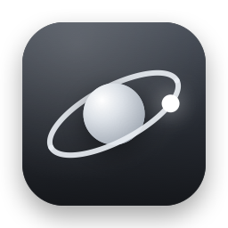
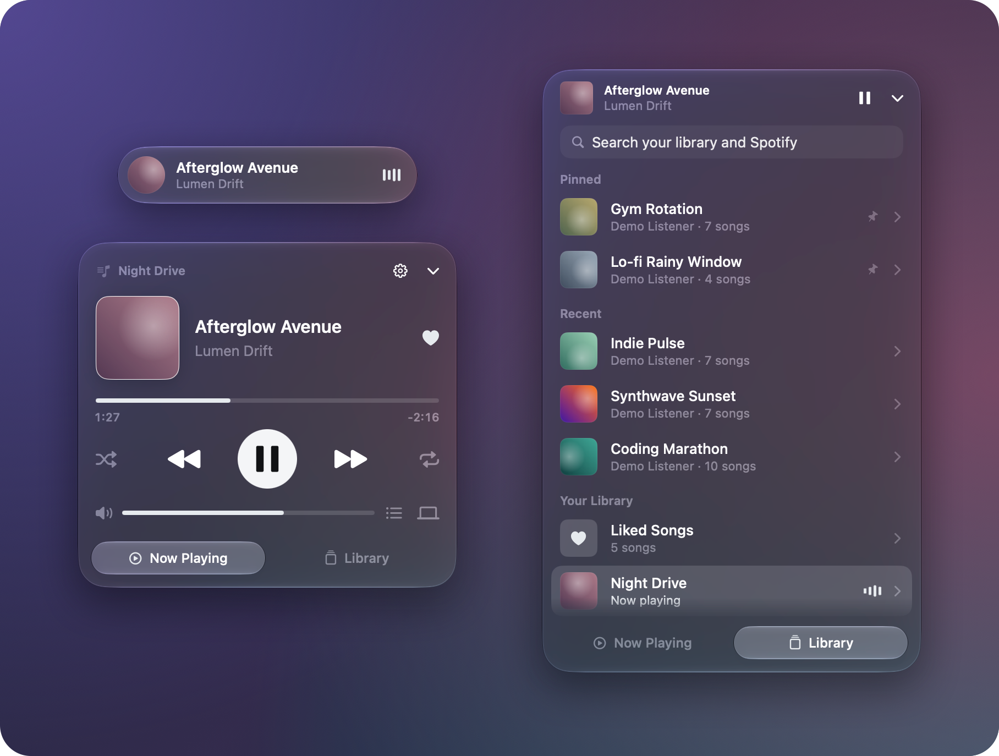

<p align="center">
  
</p>

# Orbit

A small floating Spotify controller for macOS. A translucent pill sits above your windows and expands into a player and your library, so you can change what's playing without switching to Spotify. The Spotify app still plays the audio; Orbit controls it.



## Features

- **Floating pill** with artwork, track info and hover controls. Drag it anywhere; it snaps to screen edges and remembers its spot on each display.
- **Full player** with seek, shuffle, repeat, volume, Liked Songs, the queue and Spotify Connect devices.
- **Library and search** in one list: pinned and recent playlists, your library, and Spotify search.
- **Liquid Glass look** with light and dark modes, glass presets and accent colors.
- **Menu bar item, global shortcuts and keyboard control.**
- **No server and no analytics.** Orbit talks only to Spotify.

Playback controls work without signing in while the Spotify app is running. The library, search, queue and devices need a Spotify sign-in. The [user guide](docs/USER_GUIDE.md) covers every feature and shortcut.

## Requirements

- macOS 26 or later
- The Spotify desktop app
- Spotify Premium and your own free Client ID ([5-minute setup](docs/SPOTIFY_SETUP.md)), unless a friend [built your copy with theirs](docs/SHARING.md)

## Install

There are two ways to install Orbit. Either way, finish by [connecting it to Spotify](docs/SPOTIFY_SETUP.md).

### Option 1: Download (recommended)

1. Download `Orbit-<version>.dmg` from [Releases](https://github.com/ntony-dev/orbit/releases), open it, and drag Orbit onto the Applications folder.
2. Open Orbit. Releases aren't notarized, so macOS blocks the first launch. Click **Done** (not Move to Trash), then go to **System Settings > Privacy & Security** and click **Open Anyway**. You only need to do this once per download.
3. Orbit has no Dock icon. Look for the pill on screen and the Orbit icon in the top menu bar, near the clock.

Don't turn off Gatekeeper to run Orbit. If you'd rather not trust a downloaded app, use Option 2. If macOS says Orbit is damaged, see [Troubleshooting](docs/TROUBLESHOOTING.md).

<details>
<summary><b>Option 2: Build it yourself</b></summary>

<br>

Build Orbit from this code on your own Mac. macOS doesn't block a copy you built, so there's no Open Anyway step.

1. Install [Xcode](https://apps.apple.com/app/xcode/id497799835) from the App Store and open it once to finish setup. A paid developer account isn't needed.
2. In Terminal, run:

   ```
   git clone https://github.com/ntony-dev/orbit.git
   cd orbit
   xcodebuild -project Orbit.xcodeproj -scheme Orbit -configuration Release -derivedDataPath build build
   cp -R build/Build/Products/Release/Orbit.app /Applications/
   ```

3. Open Orbit from your Applications folder.

</details>

## Known limitations

- Spotify's Development Mode allows five users per Client ID and requires the app owner to have Premium.
- Track lists only load for playlists you own or collaborate on.
- Switching devices needs Spotify Premium.
- Releases aren't notarized and don't update automatically.

The [user guide](docs/USER_GUIDE.md#known-limitations) has the full list.

## Privacy

Orbit has no server, analytics or crash reporting. It talks only to Spotify and keeps your tokens in your login keychain. Permissions, data handling and security notes are in [docs/PRIVACY.md](docs/PRIVACY.md).

## Development

Running from Xcode, demo mode, signing, releases and the project layout are in [docs/DEVELOPMENT.md](docs/DEVELOPMENT.md).

## License

MIT. See [LICENSE](LICENSE). Global shortcuts use [KeyboardShortcuts](https://github.com/sindresorhus/KeyboardShortcuts) by Sindre Sorhus (MIT).

Orbit is an independent project, not affiliated with, endorsed by or sponsored by Spotify. Spotify is a trademark of Spotify AB.
