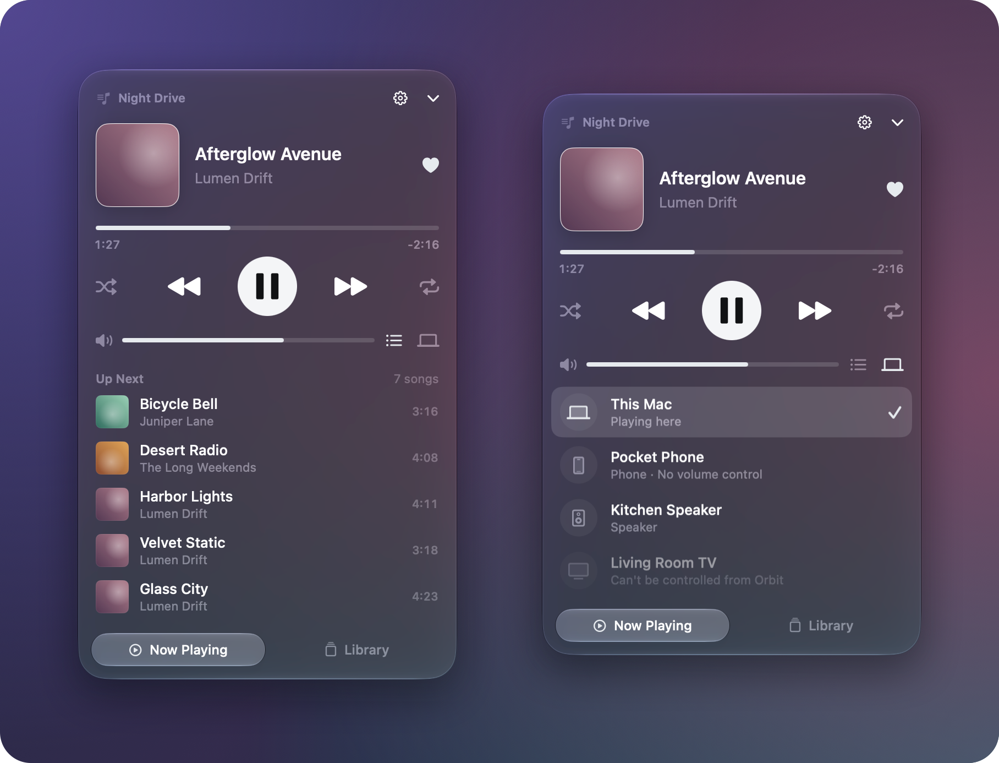
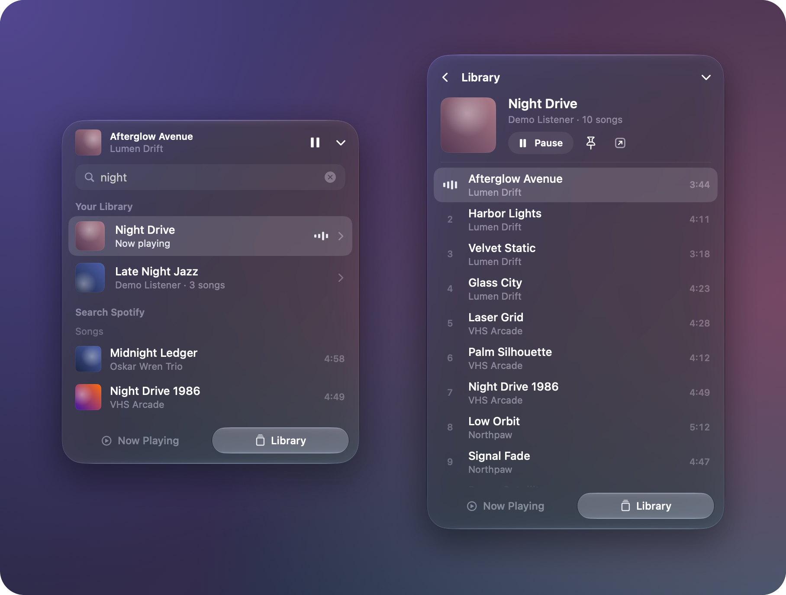

# Orbit user guide

## Screenshots

Captured in demo mode, with made-up playlists and artwork, over a stand-in wallpaper.






## What needs a sign-in

Without signing in, Orbit controls the Spotify app on this Mac through macOS Automation. Signing in adds playlists, Liked Songs, search, the queue, saving songs and switching devices.

## The pill

- Shows artwork, title, artist and a playing indicator.
- Hover to show previous, play/pause and next.
- Click to expand, drag to move.
- **Sizes:** Regular or Compact. Compact shows only the title, and only play/pause and next on hover.

## The player

- Artwork, title and artist, with a heart to save or remove from Liked Songs.
- A seek bar with the elapsed and remaining time.
- Shuffle, previous, play/pause, next, and repeat (off, all or one).
- Volume, with buttons beside it that open the queue and the Spotify Connect device list.
- **Queue:** click a song to skip to it. The songs before it are skipped, as in Spotify.
- The playlist name at the top opens the library. The gear opens Settings.

## The library

One list, in this order: pinned playlists, the three playlists you most recently started from Orbit, then Liked Songs and the rest of your playlists. Each playlist appears only once.

- **Play a playlist:** click its cover. On the playlist that's playing, the cover pauses or resumes it.
- **See its tracks:** click anywhere else on the row. From there you can play a single song, pin the playlist or open it in Spotify. Spotify only shares the tracks of playlists you own or collaborate on.
- **Go back:** click the Library title, or press ← or Escape.
- **Search:** typing filters your playlists instantly. After a short pause, Spotify's matching songs, albums and playlists appear below.
- **Play a song or album:** click it. Clicking the album that's playing pauses or resumes it.
- **Reorder pins:** drag them, or use Settings > Spotify.
- **Right-click a song:** play it, add it to the queue, or open it in Spotify. In the queue: skip to it, or open it in Spotify.
- **Right-click an album:** play it or open it in Spotify.
- **Right-click a playlist:** play, show tracks, pin or unpin, move a pin up or down, remove from recents, or open in Spotify.

After you pick a playlist, its row shows a spinner until Spotify starts playing it, then a checkmark. If Spotify doesn't start it, the row says why. Click the cover to try again.

## Window and behavior

- **Panel (Settings > Behavior):** show the pill, keep above other windows, collapse after choosing music (off by default), and collapse when clicking outside.
- **Position (Settings > Behavior):** snap to screen edges, dock at top center, and remember position. Orbit keeps a position for each display, moves the pill back when a display reconnects, and recovers it if it ends up off screen. Reset Position brings it back.
- **Hide automatically (Settings > Behavior):** while another app is full screen, and when Spotify quits.
- **Startup (Settings > Behavior):** launch at login.
- **Devices (Settings > Spotify):** a preferred Spotify Connect device.
- **Sync (Settings > Spotify):** choose how often Orbit checks for playback on your other devices: Automatically, Less often, or Only while Orbit is open. Refresh Now reloads your library. See "How often Orbit talks to Spotify" under [More details](SPOTIFY_SETUP.md#more-details).
- **Appearance:** system, light or dark; Clear, Balanced or Tinted glass; background opacity; five accent colors plus a custom one; pill size and artwork; and Reduce animation.
- **About the glass:** macOS Liquid Glass has two native variants, clear and regular. The presets use those plus a backing layer and tint that Orbit draws itself. Orbit can't change how strongly the glass blurs.
- **Global shortcuts:** open or close Orbit, search, play/pause, next, previous, and open the library. All are off until you set a key combination in Settings > Shortcuts.

## Menu bar icon

Orbit's icon sits in the top menu bar. Click it for: now playing, playback controls, open the player, library or search, show or hide the pill, reset its position, About Orbit (which lists third-party licenses), Settings and Quit.

## Keyboard

These keys work while the expanded panel is active, meaning after you click the pill or open it from the menu bar icon or a shortcut. Where Spotify's desktop app has a shortcut for the same action, Orbit uses it.

| Key | Action |
|---|---|
| Space | Play or pause |
| ← / → | Seek 10 seconds (player) |
| → / ← | Open the selected playlist's tracks / go back (library) |
| ⌘← / ⌘→ | Previous / next track |
| ⌘↑ / ⌘↓ | Volume up / down by 10 |
| ↑ / ↓ | Move the selection in a list |
| Return | Play the selection, or the top match while filtering |
| Escape | Clear the field; otherwise go back one step, or collapse Orbit from the player |
| ⌘, | Open Settings |
| Typing | Goes into the search or filter field |

While the library's search field has focus:

- ↑, ↓ and Return still control the list.
- Once you've used the arrows to select a row, → opens that row.
- Space types a space instead of playing or pausing.

Holding a key repeats seeking, skipping and volume changes, but not play/pause or Escape.

## Accessibility

- **VoiceOver:** every control has a label. The pill reads as one button, with Play or Pause, Next Track and Previous Track as actions. Each library row reads as one item, with its right-click commands as actions.
- **Reduce Motion:** animations are shorter and slides become fades. Settings > Appearance > Reduce animation does the same for Orbit only.
- **Reduce Transparency:** draws an almost opaque backing under the glass, whatever the opacity slider is set to.
- **Increase Contrast:** a more opaque backing, borders around the pill and panel, and stronger fills and selection colors.

## Performance

On one Mac, a Release build in demo mode with the pill collapsed and music playing used about 0.1% CPU and 27 MB of memory. A real Spotify account adds network requests, and your numbers will differ.

## Installing from a release

1. Download `Orbit-<version>.dmg` from Releases. If the release lists a SHA-256 checksum, compare it:

   ```
   shasum -a 256 ~/Downloads/Orbit-<version>.dmg
   ```

2. Open it and drag Orbit onto the Applications folder, then eject the Orbit disk in Finder's sidebar. The image also contains the license and third-party notices.
3. Open Orbit and get past Gatekeeper (see below).
4. Orbit has no Dock icon. Look for the pill on screen and the Orbit icon in the top menu bar.

### Gatekeeper

Releases are signed ad hoc and not notarized, because notarization requires a paid Apple Developer membership. So on first launch, macOS says it couldn't verify Orbit. If you trust where you got it:

1. Click **Done** (not Move to Trash).
2. Go to **System Settings > Privacy & Security**, scroll to Security, and click **Open Anyway**.
3. Confirm with your password or Touch ID.

You only do this once per download. Right-click > Open no longer works for this on current macOS.

- Don't disable Gatekeeper or strip the quarantine flag. If you'd rather not trust the binary, build from source.
- If macOS says Orbit is damaged, the copy is broken. See [TROUBLESHOOTING.md](TROUBLESHOOTING.md).
- After each update, macOS asks for Keychain and Automation access again, because each ad-hoc build has a different signature. See [TROUBLESHOOTING.md](TROUBLESHOOTING.md).

## Known limitations

- **Development Mode:** at most five users per Client ID, the app owner needs Spotify Premium, and one request quota is shared by all of the owner's Development Mode apps and everyone using them.
- **Playlist tracks:** Orbit can only list tracks for playlists you own or collaborate on. Other playlists still play.
- **Search:** returns at most 10 songs, 10 albums and 10 playlists. Artists, podcasts and audiobooks aren't searched.
- **Repeat One:** needs a sign-in, because AppleScript only supports repeat on or off.
- **Other devices:** switching devices and controlling Spotify on other devices require Premium.
- **Port 8888:** the sign-in callback port can't be changed, and sign-in fails while another program is using it.
- **Updates:** releases aren't notarized and don't update automatically.
- **Audio:** Orbit doesn't play audio itself. Without a sign-in, it can only control the Spotify desktop app on the same Mac.
